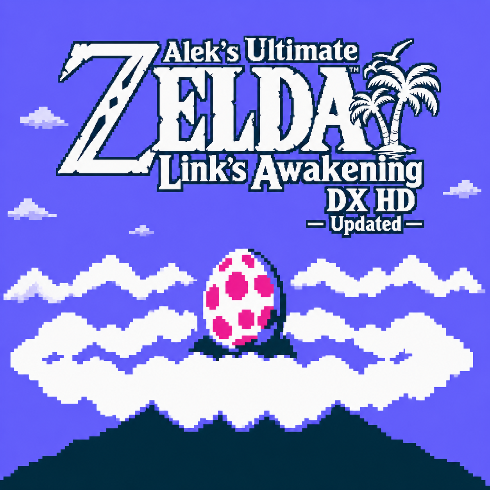
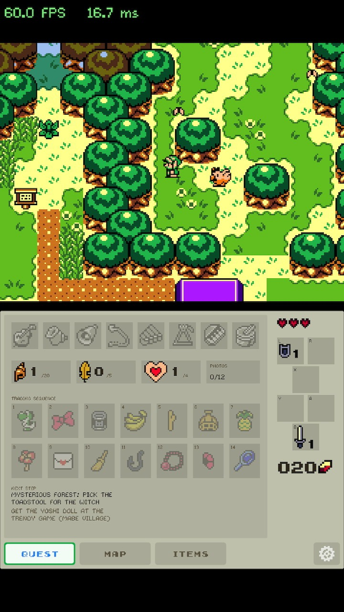
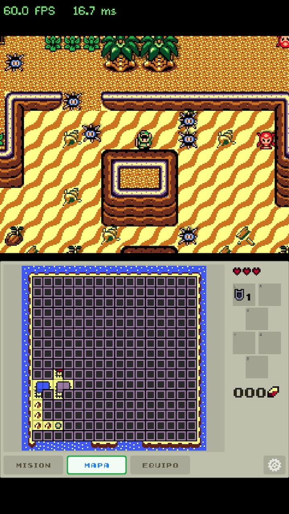
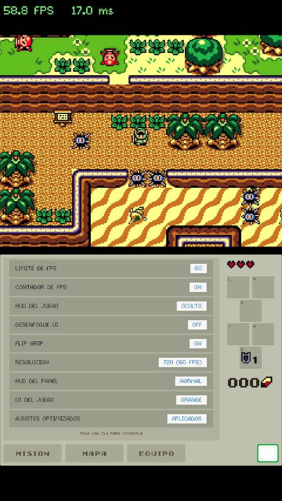
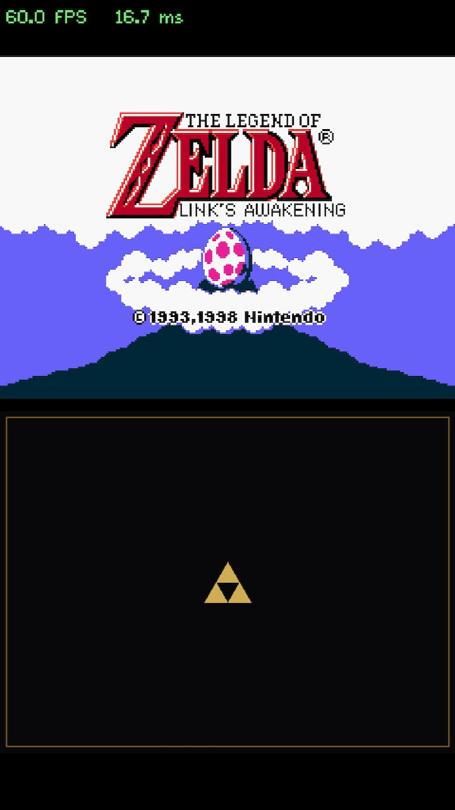
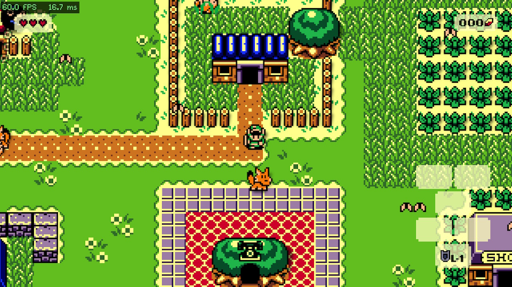
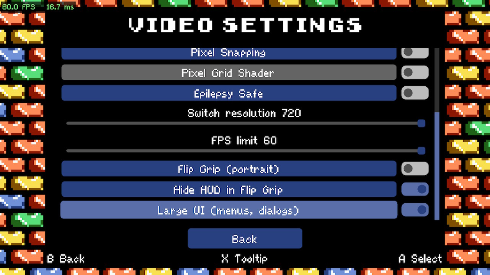
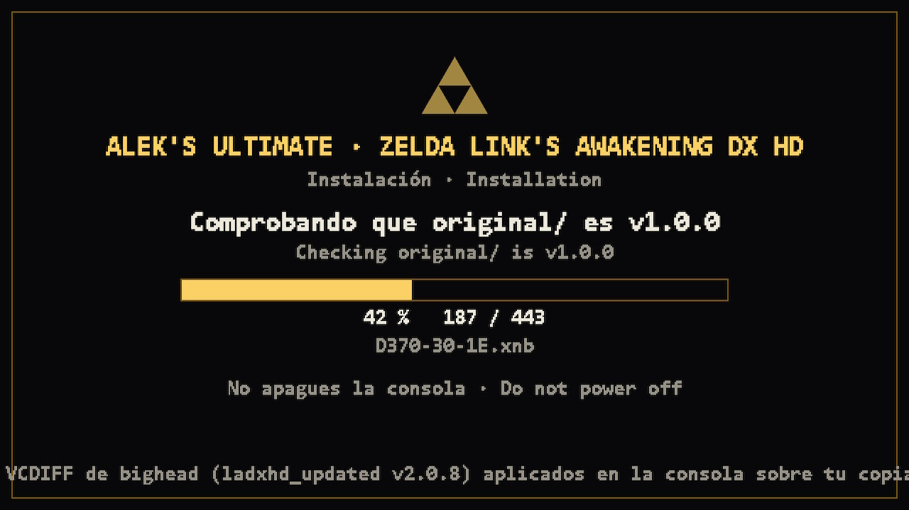

<h1 align="center">The Legend of Zelda: Link's Awakening DX HD — Alek's Ultimate NX Edition</h1>

Nintendo Switch homebrew port of <a href="https://gitlab.com/bighead.0/ladxhd_updated">bighead's <i>ladxhd_updated</i></a> (v2.0.9) — 60 fps in handheld, Flip Grip portrait mode with a touch companion panel, in-game Switch settings. Since v1.1 it installs itself on the console from your v1.0.0 copy: no PC, no patcher.

<a href="#english">English</a> · <a href="#español">Español</a> · <a href="https://gbatemp.net/threads/release-zelda-links-awakening-dx-hd-aleks-ultimate-nx-edition-switch-homebrew-60fps-flip-grip-touch-second-screen.684512/">GBAtemp thread</a> · <a href="https://github.com/Alexgg1014/The-Legend-of-Zelda-Link-s-Awakening-DX-HD-Alek-s-Ultimate-NX-Edition/releases">Releases</a>

---

## English

> **Unofficial fan project.** This repository contains **no game assets**. You need your own copy of *Link's Awakening DX HD* v1.0.0 and bighead's patcher. All game art, music and maps belong to Nintendo; the HD remake code is bighead's; this port only adds the Switch layer.

### Screenshots

   

 

### Features

- **60 fps in handheld, no overclock** — renders at 720p (the handheld screen's real resolution) instead of 1080p. 1080p mode available for docked play (30 fps).
- **Flip Grip / portrait mode** (`L + R + X`): game on top in 4:3, **companion panel** below, DS-style — same layout as the Alek's Ultimate editions of *Minish Cap* and *A Link to the Past*.
- **Touch companion panel** with four tabs:
  - **QUEST** — the 8 instruments, seashells, golden leaves, heart pieces, photos, the 14-step **trading sequence**, and a **story guide** ("next step") worked out from your inventory.
  - **MAP / DUNGEON** — the game's own map, auto-switches to the dungeon map when you enter one.
  - **ITEMS** — your bag, TMC-style: **tap an item to put it on A**, or **drag it onto any button** (A/B/X/Y, or L/R if you use 6 buttons).
  - **⚙ SETTINGS** — fps limit, fps counter, game HUD on/off, UI blur, Flip Grip, resolution, panel HUD size, game UI size, and an **Optimized Settings** preset (two taps to confirm).
- **Sidebar HUD** on the panel (hearts, equipped items in the button layout, rupees, keys) so the game HUD can be hidden in Flip Grip.
- **Switch options inside the game's own menu** — Pause → Settings → Video: resolution, fps limit, Flip Grip, hide HUD, large UI.
- Panel **and** the Switch rows in the game's own Video menu translated to **English, Spanish, Portuguese, French, German and Italian** (follows the game language). The story guide is in all six too, using each language's official place, dungeon and character names from the game's own files.
- **In-app updater** (new in v1.2) — check, download and install a new version from the companion panel, without a PC. The download is checked against a size and SHA-256 pinned in a manifest, a verified backup of your current NRO is made first, and any failure restores it. See [Updating](#updating).
- Zero new art: everything on the panel is drawn from the game's own sprites, fonts and colors (respects your LAHDMods).

### Requirements

- Nintendo Switch with **Atmosphère** (tested on a v1 Switch, handheld). Launch from **hbmenu via title override** (hold R on a game), *not* from the Album — the Album applet doesn't have enough memory.
- Your own **Link's Awakening DX HD v1.0.0** (the PC release: the `Content` and `Data` folders). No PC or patcher needed since v1.1: the NRO patches it on the console.

### Install (v1.1+: in-game installer)

1. On the SD card create `sdmc:/switch/zelda-ladxhd/` and copy into it:
   - `ProjectZ.Switch.nro` (from this repo's release)
   - a folder named `original/` with your **untouched v1.0.0** `Content/` and `Data/` folders inside (copying the whole game folder into `original/` also works)
2. Launch from hbmenu. The first start shows an install screen: the NRO checks that `original/` really is v1.0.0, applies bighead's v2.0.9 patches on the console (about a minute) and creates `Content/` and `Data/` next to the NRO. Then the game starts.
3. Keep `original/`: future updates re-patch from it. If you'd rather save space, you can delete it after installing and copy it back when a new version comes out.

If you already installed v1.0.0 the old way (patcher on PC + copying `Content`/`Data`), nothing changes: the NRO sees the folders and starts the game as before.

The installer only accepts a clean v1.0.0 copy. If it says *"original/ is not Link's Awakening DX HD v1.0.0"*, you copied an already-patched folder — use the original release files.

Your settings live in `sdmc:/switch/zelda-ladxhd/switchsettings.txt` (plain text) and saves in `SaveFiles/`.

### Controls

| Combo | Action |
|---|---|
| `L + R + X` | Toggle Flip Grip (portrait) ↔ normal |
| `L + R + ←/→` | Switch companion tab without touching |
| Touch | Tabs, settings rows, items (tap = A, drag = choose button) |

Everything else is the game's own controls.

### Known issues / notes

- 1080p mode holds 30 fps (GPU bound); 720p is the default and hits 60.
- Story guide and the Video-menu options are English/Spanish only (the panel itself has 6 languages).
- Docked mode is untested; Flip Grip is a handheld feature.
- If the game ever shows a black panel or the touch stops responding, check `crash/secondscreen.log` on the SD and open an issue with it.

### Updating

**Since v1.2 the port updates itself from the console.** Open the companion panel, go to
**⚙ SETTINGS → UPDATE** and tap the row:

1. It fetches a small manifest from this repository over HTTPS. No connection, or GitHub
   unreachable? It just says "no connection" and nothing else happens — the installed game is
   untouched.
2. If there is a newer version, the row shows it. Tap **twice** to confirm (overwriting the NRO
   you are running is not something a stray touch should start).
3. It downloads the new NRO, checks its size **and SHA-256 against the manifest**, makes a
   **verified backup** of your current NRO as `ProjectZ.Switch.bak` next to it, installs, and
   verifies again. If anything goes wrong at any point, the backup is restored.
4. When it says "done", close the game and launch it again.

The console's own TLS and certificate store are used, so there are no bundled certificates. The
download is only ever accepted from `github.com` / `*.githubusercontent.com` over HTTPS.

If the new NRO needs newer assets, it regenerates `Content`/`Data` from `original/` on the next
start — that is why it is worth keeping `original/`.

**Coming from v1.1.0 or v1.0.0?** Those builds have no updater, so this one time you still
replace `ProjectZ.Switch.nro` by hand. After that the console does it.

Manual installs (patcher on PC) keep working as before: use the patcher version named in the
release notes. Each release ships the NRO **with the patches of the upstream version it was
built for embedded** (with bighead's permission); when bighead releases a new version, this port
gets rebased and re-released.

### Building

The Switch layer lives entirely in `ProjectZ.Switch/` (C#, NativeAOT for linux-arm64 linked with devkitPro/libnx), plus a handful of small, documented patches to `ProjectZ.Core` (`RenderSizeOverride`, `UiScaleRoundUp`, `IPlatformVideoOptions`). See `SWITCH_BUILD.md` in the source.

### Transparency: built with AI

This port was developed by Alexgg1014 **with Claude (Anthropic) as a coding assistant**: a large part of the Switch layer, the debugging of the NativeAOT/libnx crashes and the rendering fixes were written in pair-programming sessions with the AI, with Alex directing the design, testing every build on real hardware and making the calls. The cover art was made with AI image generation and then hand-edited. Nothing here is autogenerated without a human having tested it on a Switch; if something is broken, it's on us, not on the model — open an issue.

### Credits

- **bighead** — [ladxhd_updated](https://gitlab.com/bighead.0/ladxhd_updated), the HD remake this port is built on, and its patcher. The VCDIFF patches embedded in the NRO (v1.1+) are bighead's, included with explicit permission; the in-game installer reimplements the patcher's logic and reads his `file_targets_xnb.txt` for the derived-file map.
- **delsonazevedo** — [Zelda-LA-DX-HD-Updated](https://github.com/delsonazevedo/Zelda-LA-DX-HD-Updated), the **first Switch port** of LADXHD (v1.7.x, NativeAOT + libnx). This edition started from that work; the shims and the build pipeline descend from it.
- **Alexgg1014** — this edition: v2.0.x rebase, 60 fps, Flip Grip mode, companion panel, Switch settings.
- **MonoGame**, **devkitPro / libnx**, **SDL2**, **Mesa** — the stack that makes .NET run on a Switch.
- The Alek's Ultimate editions of *The Minish Cap* and *A Link to the Past* — donors of the second-screen design.
- Nintendo — *The Legend of Zelda: Link's Awakening DX*. This project is not affiliated with or endorsed by Nintendo.

---

## Español

> **Proyecto fan no oficial.** Este repositorio **no incluye assets del juego**. Necesitas tu propia copia de *Link's Awakening DX HD* v1.0.0 y el patcher de bighead. El arte, la música y los mapas son de Nintendo; el código del remake HD es de bighead; este port solo añade la capa de Switch.

### Qué es

- **60 fps en portátil sin overclock**: renderiza a 720p (la resolución real de la pantalla) en vez de 1080p. Modo 1080p disponible para dock (30 fps).
- **Modo Flip Grip / vertical** (`L + R + X`): juego arriba en 4:3, **panel companion** abajo, estilo DS — el mismo layout que las ediciones Alek's Ultimate de *Minish Cap* y *A Link to the Past*.
- **Panel táctil** con cuatro pestañas:
  - **MISIÓN** — los 8 instrumentos, caracolas, hojas doradas, piezas de corazón, fotos, la **cadena de intercambio** de 14 pasos y una **guía de historia** ("siguiente paso") deducida de tu inventario.
  - **MAPA / MAZMORRA** — el mapa del propio juego; cambia solo al mapa de la mazmorra al entrar.
  - **EQUIPO** — tu bolsa, a lo TMC: **toca un objeto para ponerlo en A**, o **arrástralo a cualquier botón** (A/B/X/Y, o L/R si usas 6 botones).
  - **⚙ AJUSTES** — límite de fps, contador, HUD del juego, desenfoque UI, Flip Grip, resolución, tamaño del HUD del panel, tamaño de la UI del juego y un preset de **Ajustes Optimizados** (dos toques para confirmar).
- **HUD en la barra lateral** del panel (corazones, objetos equipados en la forma de los botones, rupias, llaves), para poder ocultar el HUD del juego en Flip Grip.
- **Opciones Switch dentro del menú del juego**: Pausa → Ajustes → Vídeo: resolución, límite de fps, Flip Grip, ocultar HUD, UI grande.
- El panel **y** las filas de Switch del menú Vídeo del propio juego, traducidos a **inglés, español, portugués, francés, alemán e italiano** (siguen el idioma del juego). La guía de historia también está en los seis, con los nombres oficiales de lugares, mazmorras y personajes de cada idioma, sacados de los ficheros del propio juego.
- **Updater in-app** (nuevo en la v1.2) — comprueba, descarga e instala una versión nueva desde el panel companion, sin pasar por el PC. La descarga se comprueba contra el tamaño y el SHA-256 fijados en un manifiesto, antes se hace una copia de seguridad verificada de tu NRO actual, y cualquier fallo la restaura. Ver [Actualizaciones](#actualizaciones).
- Cero arte nuevo: todo el panel se dibuja con los sprites, fuentes y colores del propio juego (respeta tus LAHDMods).

### Requisitos

- Switch con **Atmosphère** (probado en Switch v1, portátil). Lanzar desde **hbmenu con title override** (mantener R al abrir un juego), *no* desde el Álbum: al applet del Álbum no le alcanza la memoria.
- Tu **Link's Awakening DX HD v1.0.0** (la versión de PC: las carpetas `Content` y `Data`). Desde v1.1 no hace falta PC ni patcher: el NRO lo parchea en la consola.

### Instalación (v1.1+: instalador in-game)

1. En la SD crea `sdmc:/switch/zelda-ladxhd/` y copia dentro:
   - `ProjectZ.Switch.nro` (de la release de este repo)
   - una carpeta `original/` con las carpetas `Content/` y `Data/` de tu **v1.0.0 sin tocar** (también vale copiar la carpeta del juego entera dentro de `original/`)
2. Lanza desde hbmenu. El primer arranque muestra una pantalla de instalación: el NRO comprueba que `original/` es de verdad v1.0.0, aplica en la consola los parches v2.0.9 de bighead (cosa de un minuto) y crea `Content/` y `Data/` junto al NRO. Después arranca el juego.
3. Conserva `original/`: las actualizaciones futuras vuelven a parchear desde ahí. Si prefieres ahorrar espacio, puedes borrarla tras instalar y volver a copiarla cuando salga versión nueva.

Si ya instalaste v1.0.0 a la antigua (patcher en PC + copiar `Content`/`Data`), no cambia nada: el NRO ve las carpetas y arranca el juego como siempre.

El instalador solo acepta una copia limpia de v1.0.0. Si dice *"original/ no es Link's Awakening DX HD v1.0.0"*, has copiado una carpeta ya parcheada: usa los ficheros de la release original.

Tus ajustes están en `sdmc:/switch/zelda-ladxhd/switchsettings.txt` (texto plano) y las partidas en `SaveFiles/`.

### Controles

| Combo | Acción |
|---|---|
| `L + R + X` | Flip Grip (vertical) ↔ normal |
| `L + R + ←/→` | Cambiar pestaña del panel sin tocar |
| Toque | Pestañas, filas de ajustes, objetos (toque = A, arrastre = elegir botón) |

Lo demás son los controles del juego.

### Problemas conocidos / notas

- El modo 1080p se queda en 30 fps (límite de GPU); 720p es el predeterminado y llega a 60.
- La guía de historia y las opciones del menú de Vídeo están solo en inglés/español (el panel en 6 idiomas).
- Modo dock sin probar; Flip Grip es una función portátil.
- Si el panel sale negro o el toque deja de responder, mira `crash/secondscreen.log` en la SD y abre un issue con él.

### Actualizaciones

**Desde la v1.2 el port se actualiza solo desde la consola.** Abre el panel companion, vete a
**⚙ AJUSTES → ACTUALIZAR** y toca la fila:

1. Se baja un manifiesto pequeño de este repositorio por HTTPS. ¿Sin conexión, o GitHub caído?
   Pone "sin conexión" y ya está — el juego instalado no se toca.
2. Si hay versión nueva, la fila la enseña. Toca **dos veces** para confirmar (sobrescribir el
   NRO que estás ejecutando no puede dispararse por un roce en la pantalla).
3. Descarga el NRO nuevo, comprueba su tamaño **y su SHA-256 contra el manifiesto**, hace una
   **copia de seguridad verificada** de tu NRO actual como `ProjectZ.Switch.bak` al lado,
   instala y vuelve a verificar. Si algo falla en cualquier punto, restaura la copia.
4. Cuando diga "listo", cierra el juego y vuelve a lanzarlo.

Se usa el TLS y el almacén de certificados de la propia consola, así que no hay certificados
embebidos. La descarga solo se acepta desde `github.com` / `*.githubusercontent.com` por HTTPS.

Si el NRO nuevo necesita assets más nuevos, regenera `Content`/`Data` desde `original/` en el
siguiente arranque (por eso conviene conservar `original/`).

**¿Vienes de la v1.1.0 o la v1.0.0?** Esas no llevan updater, así que esta vez todavía tienes
que sustituir `ProjectZ.Switch.nro` a mano. A partir de ahí lo hace la consola.

Las instalaciones manuales (patcher en PC) siguen funcionando igual: usa la versión del patcher
que digan las notas de la release. Cada release lleva el NRO **con los parches de la versión de
upstream para la que se compiló embebidos** (con permiso de bighead); cuando bighead publique
versión nueva, el port se rebasa y se vuelve a publicar.

### Transparencia: hecho con IA

Este port lo desarrolló Alexgg1014 **con Claude (Anthropic) como asistente de programación**: buena parte de la capa de Switch, la depuración de los crashes de NativeAOT/libnx y los fixes de render se escribieron en sesiones de pair-programming con la IA, con Alex dirigiendo el diseño, probando cada build en consola real y tomando las decisiones. La portada se generó con IA y se retocó a mano. Nada aquí es autogenerado sin que un humano lo haya probado en una Switch; si algo falla es cosa nuestra, no del modelo — abre un issue.

### Créditos

- **bighead** — [ladxhd_updated](https://gitlab.com/bighead.0/ladxhd_updated), el remake HD sobre el que va este port, y su patcher. Los parches VCDIFF embebidos en el NRO (v1.1+) son de bighead, incluidos con su permiso explícito; el instalador in-game reimplementa la lógica del patcher y lee su `file_targets_xnb.txt` para el mapa de ficheros derivados.
- **delsonazevedo** — [Zelda-LA-DX-HD-Updated](https://github.com/delsonazevedo/Zelda-LA-DX-HD-Updated), el **primer port a Switch** de LADXHD (v1.7.x, NativeAOT + libnx). Esta edición partió de ese trabajo; los shims y el pipeline de build descienden de ahí.
- **Alexgg1014** — esta edición: rebase a v2.0.x, 60 fps, modo Flip Grip, panel companion, ajustes Switch.
- **MonoGame**, **devkitPro / libnx**, **SDL2**, **Mesa**.
- Las ediciones Alek's Ultimate de *The Minish Cap* y *A Link to the Past*, donantes del diseño de segunda pantalla.
- Nintendo — *The Legend of Zelda: Link's Awakening DX*. Este proyecto no está afiliado ni respaldado por Nintendo.
